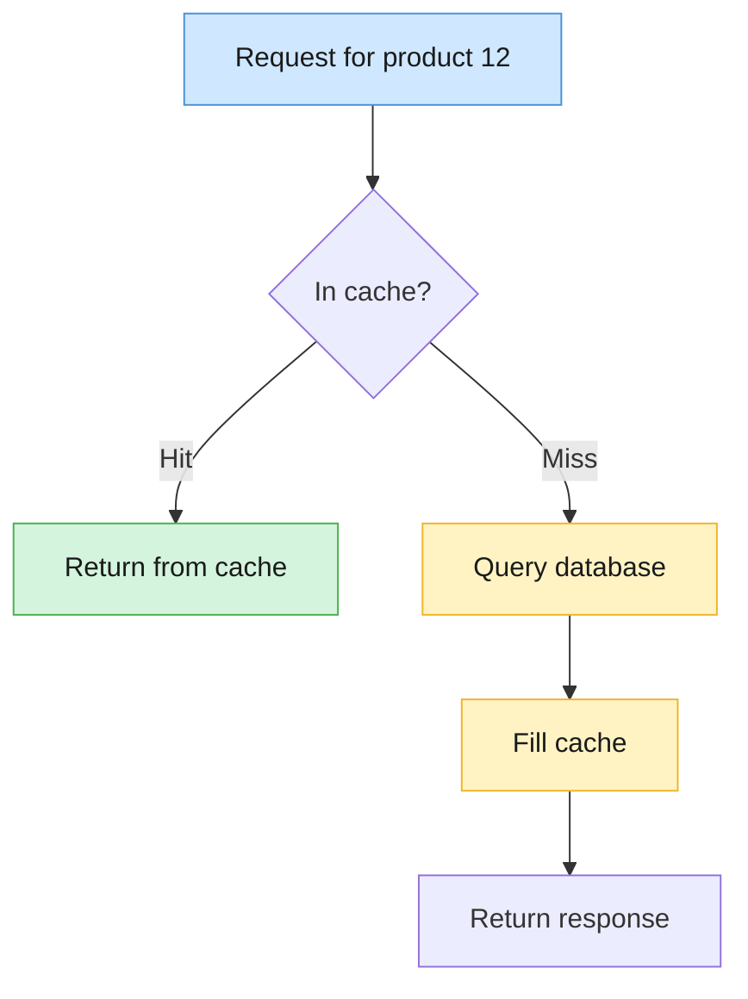
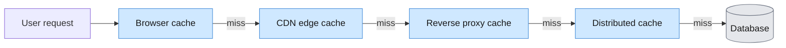

# Caching Overview: Why, What, When, Where, and Why Not Everything

## 1. Overview
Caching is the practice of keeping a temporary copy of data or a computed result in a faster, closer storage layer so it can be reused instead of fetched or recomputed every time. The walkthrough covers why caching is needed, what it is, the main scenarios where it helps, where caches live in a system, and why we can't simply cache everything. Caching protects the database, reduces latency and throughput bottlenecks, and cuts costs from expensive operations or paid third-party calls.

### Core mental model
The basic request flow for a cache sits between the application and the database. Every read asks the cache first.

## 2. Why Caching Is Needed
The need for caching comes from a chain of problems, each of which the simpler fix fails to solve.

- **The database gets overloaded.** When a product becomes popular, many users request the same ID. Every request goes to the database, and at around a million requests the database can crash.
- **Replicating the database only partly helps.** Adding a second database (DB1 and DB2) splits the load, but both still live on disk. Disk access adds latency, so simply adding more databases is not a complete solution.
- **A faster access layer is the better answer.** Place a cache in faster memory (main memory, or SSD if the data is too large for memory) that sits close to the application.

With a cache in front of the database:

- **Latency drops** because the cache is faster and closer to the application.
- **Database load drops** because only unique requests reach the database. Repeated requests are absorbed by the cache.
- **Throughput rises** because the cache can handle a large volume of repeated requests.
- **The backend is protected** because the database is no longer hit by every repeated request.
- **Scalability improves** because the cache serves the repeated load as traffic grows.

## 3. What Caching Is
Caching stores a temporary copy of data or a computed result in a faster, more accessible location. The key word is **reuse**: once data has been fetched or computed, it is saved so the next request can be served from the fast copy rather than being recomputed or re-fetched.

The first request for a key is always slower, because the cache is empty and the data must come from the source. Every request after that can be served from the cache.

## 4. Cache Hit, Cache Miss, and Hit Ratio

### Cache miss
A cache miss happens when the requested data is not in the cache. The application then goes to the database, which holds the full dataset, retrieves the result, returns it to the requester, and fills the cache with it.

### Cache hit
A cache hit happens when the data is already in the cache. The response is served directly from the cache, which is much faster than going to the database.

### Cache hit ratio
The cache hit ratio measures how well the cache is performing.

> **Cache hit ratio = cache hits ÷ total requests**

Example: out of 100 requests, the cache answers 80 and 20 go to the database. The hit ratio is 80/100 = 80%, and the miss ratio is 20%. A higher hit ratio indicates that the caching algorithm and eviction policy are working well.

## 5. When to Use Caching: Scenarios
The transcript describes seven scenarios where caching is a good fit. Each is written so it can stand alone, and new scenarios can be added as extra subsections.

### 5.1 Frequently read data and traffic spikes
If the same data is read repeatedly, caching absorbs the load. It is especially useful during traffic spikes, because the cache serves the repeated reads and the database only handles unique ones.

### 5.2 Expensive operations
Caching is valuable when an operation is costly to compute or to pay for, not just slow. Examples from the transcript:

- Complex computations, scientific calculations, or large mathematical formulas
- Multi-database queries or expensive aggregations
- Paid external API calls, such as calling an LLM where each call consumes tokens
- ML inference, where the same input to the same model always returns the same answer
- Video or audio rendering, where the same output is being regenerated repeatedly

The benefit is saving on **cost**, not only latency.

### 5.3 Local hot keys
A hot key is a single item that receives a very large share of requests, such as a famous sports player whose profile everyone is searching for in one country. Because all requests target the same key, they can be served from the cache directly. This gives lower latency for hot keys, and the database is protected from being crushed by one item.

### 5.4 Global hot keys
A hot key can also be global. For example, a post by a global celebrity may be requested from every region. Serving it from one local cache in one region is not enough, because users in distant regions would have to reach that cache across the network.

The approach:

- Replicate the database across regions (for example US, APAC, and EU). The regional databases sync with each other.
- Each region loads its own **regional cache** from the synced data.
- Users are served from their nearest region, which makes this a **distributed cache** design.

### 5.5 Reducing geographic latency
Network latency grows with distance. A user in Asia who must reach a server in the United States pays a large latency cost on every request. Keeping copies of data in a local or regional cache keeps responses close to the user. This is why the distributed cache design is used for global data.

### 5.6 Multi-tier caching
Caching is rarely a single layer. A request for a photo the user has opened before can be served from several cache layers before it reaches the database. Each layer that holds the data returns it immediately, and only a miss at every layer reaches the origin database. See [Where Caches Can Live](#6-where-caches-can-live) for the layer order.

### 5.7 Reducing calls to expensive downstream systems
If an application repeatedly asks a third-party API for the same information, for example the latitude and longitude of a fixed address, each call may cost money or count against rate limits. Storing the first response avoids paying for the same answer again.

## 6. Where Caches Can Live
Caches exist at many points between the user and the data source.

| Location | Type | Notes |
|---|---|---|
| Browser | Client-side cache | Stores content the user has already opened, such as photos |
| CDN | Edge cache | Holds static content close to the user at the network edge |
| Forward or reverse proxy | Gateway cache | The reverse proxy sits at the origin, as the entry point into the backend |
| Distributed cache | Origin backend cache | Shared cache across servers and regions |
| Application local cache | In-process cache | Uses the CPU cache and main memory, the fastest option |

### Multi-tier request path
A request for an image passes through each layer in order. The first layer that holds the data returns it, and only a miss at every layer reaches the database.

## 7. Cache Storage Tiers
Caches can use different levels of the memory and storage stack. Speed, size, and cost trade off against each other.

| Storage | Speed | Size | Typical use |
|---|---|---|---|
| CPU cache | Fastest | Very small | Used by the application's local cache |
| Main memory (RAM) | Fast | Larger than CPU cache | The usual go-to for caching; volatile, so data is lost on power loss |
| SSD | Slower than RAM | Large | Used when cached data is too large for memory |
| Hard disk | Slowest | Largest and cheapest | Saves cost, but rarely used for caching |

The main memory and SSDs are the most common choices for caching.

## 8. Why We Don't Cache Everything
Caching is powerful, but it has real limits.

### Limited and expensive memory
Cache memory is small and costly compared with a database. Copying the entire database into a cache is not practical.

### The cache is usually not the source of truth
In most cache patterns, writes go directly to the database, not to the cache. The cache must sync with the database to get the latest information, so the database remains the source of truth.

### Staleness
A cache can serve outdated data. If the database is updated but the cache is not, the cache returns old information until it is refreshed. The cache must keep track of fresh data from the database.

### Frequently changing data
If data changes every second, caching it is of little use. Each cached copy becomes stale almost immediately, so most requests still go to the database.

### Freshness tolerance decides what can be cached

| Data | Can tolerate staleness? | Cache? |
|---|---|---|
| Static image | Yes, mostly | Yes |
| Product description | Yes, for some time | Yes |
| Bank balance | No, freshness is critical | No |

### Operational complexity
Adding a cache adds more than a component. It also requires logic for:

- **Eviction policy**, which decides which entries to remove when the cache is full
- **Expiry or timeout**, which decides when an entry should expire
- **Capacity**, which decides how much data the cache should hold
- **Hot key management**, which decides how popular keys are handled

This logic makes the codebase heavier.

## 9. Related Topics to Explore
- **Cache stampede**, where many requests hit the database at the same moment when a popular cache entry expires. The transcript mentions this as a large topic covered in a separate video.

## 10. Key Takeaways
- Caching stores a temporary copy of data or a computed result in a faster location so that it can be reused instead of re-fetched or recomputed.
- A cache hit serves data from the cache, while a cache miss falls back to the database and fills the cache. The cache hit ratio measures how well the cache is performing.
- Caching is useful for frequently read data, expensive operations (including paid API and LLM calls), hot keys, geographically distributed users, multi-tier architectures, and reducing calls to downstream systems.
- Caches can exist in the browser, on a CDN, in proxies, in a distributed cache, and in the application itself, usually in layers.
- Caching is not free. Memory is limited, the cache is not the source of truth, data can go stale, and caching adds operational complexity.
- Don't cache data that must always be fresh, such as bank balances, and don't cache data that changes too frequently to be reused.
