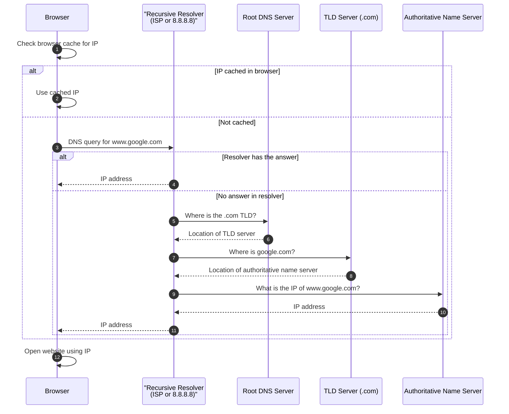
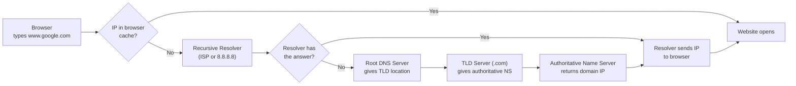

# DNS Architecture: How Domain Names Become IP Addresses

## 1. Overview
Computers find each other using IP addresses, not names. When you type a website name such as `www.google.com` into a browser, your system cannot connect to it until that name is converted into an IP address. The **Domain Name System (DNS)** performs this conversion. It works as a distributed lookup chain, where each server either answers the question or points to the next server that can.

### Core mental model
A DNS lookup is a chain of hand-offs. The browser asks a resolver, the resolver asks a root server, the root points to the TLD server, the TLD points to the authoritative server, and the authoritative server holds the actual IP address. The answer then travels back the same way.

## 2. Why DNS Is Needed
- Humans remember names like `www.google.com`. Networks route traffic using IP addresses.
- DNS maps one to the other, so users never have to type numeric addresses.

## 3. How a DNS Lookup Works, Step by Step
1. **Check the cache.** When you type a URL, the browser first checks its own cache. If the IP address is already stored there, it uses it and the lookup ends.
2. **Ask the recursive resolver.** If the IP is not cached, the query goes to a **recursive resolver**. This is run by your ISP or a public DNS service such as Google DNS (`8.8.8.8`).
3. **Resolver checks for an answer.** If the resolver already knows the IP, it returns it. If not, it continues the lookup on your behalf.
4. **Ask a root DNS server.** The root server does not know the IP. It returns the location of the **TLD (top-level domain) server** for the domain's ending, such as `.com`.
5. **Ask the TLD server.** The TLD server does not know the IP either. It returns the name of the **authoritative name server** for the domain, such as the server that manages `google.com`.
6. **Ask the authoritative name server.** This server holds the official records for the domain. It returns the IP address of `www.google.com`.
7. **Return the IP to the browser.** The resolver passes the IP address back to the browser, and the website opens.

## 4. Visual Walkthrough

### 4.1 Sequence view (who talks to whom, in order)

### 4.2 Horizontal flow (the decisions at a glance)

## 5. Key Takeaways
- **DNS converts domain names into IP addresses.** Browsers cannot connect to a site without this step.
- **Lookups move up a chain of servers.** Each server either answers or points to the next one: resolver, root, TLD, then authoritative.
- **Caching avoids repeat work.** The browser (and the resolver) can reuse an answer they already have, so most lookups do not travel the full chain.
- **The authoritative name server has the final answer.** The root and TLD servers only point the way.
- **The recursive resolver does the work for you.** Your browser asks one resolver; the resolver handles the rest and returns a single answer.

## 6. Quick Revision Checklist
- [ ] Can I explain why a browser needs an IP address before it can open a site?
- [ ] Can I name the four servers involved in a full lookup, in order?
- [ ] Can I explain what the root server returns, and what the TLD server returns?
- [ ] Can I explain when the lookup stops early, and why?
- [ ] Can I explain what a recursive resolver is and who usually runs one?
- [ ] Can I draw the lookup chain from memory?
