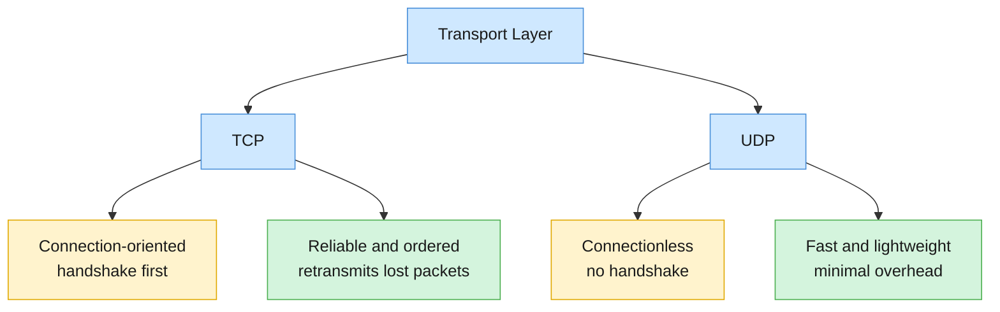

# TCP vs UDP: Transport Layer Protocols

## 1. Overview
TCP (Transmission Control Protocol) and UDP (User Datagram Protocol) are the two main transport layer protocols. They both move data between applications, but they make opposite trade-offs. TCP is connection-oriented and reliable, so it guarantees delivery and order at the cost of speed. UDP is connectionless and lightweight, so it sends data quickly with no delivery guarantee. Choosing between them depends on whether the application needs every byte to arrive correctly or needs data to arrive with minimal delay.

### Core mental model

## 2. TCP: Reliable, Connection-Oriented Delivery
TCP establishes a connection before sending data, using a **three-way handshake**. It then:

- Splits data into segments (packets) and numbers them so the receiver can put them back in order.
- Has the receiver **acknowledge** each received segment.
- **Retransmits** any segment that is lost or not acknowledged.
- Performs **flow control**, which means the sender adjusts how fast it sends so the receiver is not overwhelmed. TCP also includes congestion control to ease traffic on the network.
- Checks segments for errors, so the data that reaches the application is error-free.

**Used for:** web browsing (HTTP and HTTPS), email (SMTP), file transfer, and anything where data integrity matters more than speed. Example: Google Chrome loading a page, or Gmail.

**Drawbacks:**
- **Higher latency.** The handshake and acknowledgements add delay before and during transfer.
- **More overhead.** Acknowledgements, retransmissions, and status checks use extra bandwidth and reduce efficiency.

## 3. UDP: Fast, Connectionless Delivery
UDP sends datagrams without setting up a connection. There is no handshake, no sequence numbers, no acknowledgements, and no retransmission. Packets can arrive out of order, arrive more than once, or not arrive at all, and UDP does not fix any of this.

UDP does include an optional **checksum**, so corrupted packets can be detected and discarded. What it lacks is any recovery mechanism, so a damaged or lost packet is simply gone.

**Used for:** situations where speed matters and some data loss is acceptable, such as live video streaming, online gaming, voice calls, and DNS lookups. Example: a live stream on Twitch.

**Advantages:**
- **Low latency.** Data is sent immediately with no connection setup.
- **Low overhead.** The UDP header is 8 bytes, compared with 20 bytes minimum for TCP, so it suits real-time applications.

**Drawbacks:**
- **Unreliable.** Packets can be lost or arrive out of order.
- **No congestion control.** UDP senders can flood the network, which causes congestion and more packet loss.

## 4. TCP vs UDP at a Glance

| Feature | TCP | UDP |
|---|---|---|
| Connection | Connection-oriented (three-way handshake) | Connectionless (no handshake) |
| Reliability | Reliable: retransmits lost packets | Unreliable: no retransmission |
| Ordering | Guarantees packets arrive in order | No ordering guarantee |
| Duplicates | Prevents duplicate delivery | Packets may be duplicated |
| Error checking | Checks and ensures error-free data | Checksum detects errors, but no recovery |
| Flow and congestion control | Yes | No |
| Speed and latency | Slower, higher latency | Faster, lower latency |
| Overhead | Higher (20-byte minimum header) | Lower (8-byte header) |
| Typical uses | Web (HTTP/HTTPS), email (SMTP), file transfer | Live streaming, online gaming, voice, DNS |

## 5. Key Takeaways
- **TCP is reliable and connection-oriented.** It guarantees ordered, error-free, non-duplicated delivery by using a handshake, acknowledgements, and retransmission.
- **UDP is unreliable and connectionless.** It sends datagrams with no guarantee of delivery, order, or duplication-free arrival, but with lower latency and overhead.
- **Pick TCP when correctness matters** (web pages, email, file downloads). Pick UDP when timeliness matters more than completeness (live video, games, voice).
- **TCP's reliability costs speed.** Handshakes, acknowledgements, and retransmissions add latency and overhead.
- **UDP's speed costs reliability.** The application must handle loss and ordering itself if it needs them.

## 6. Quick Revision Checklist
- [ ] Can I explain what "connection-oriented" and "connectionless" mean?
- [ ] Can I name the three steps of the TCP three-way handshake and what each does?
- [ ] Can I explain how TCP recovers from a lost packet?
- [ ] Can I explain why UDP is faster, and what it gives up to be faster?
- [ ] Can I name two applications that use TCP and two that use UDP, and justify each choice?
- [ ] Can I explain what flow control does, and why TCP and UDP differ on it?
- [ ] Can I explain what the UDP checksum does and does not do?
