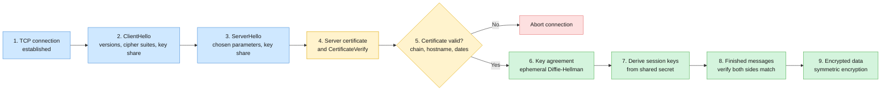
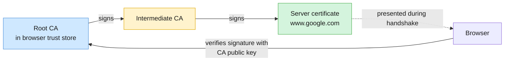
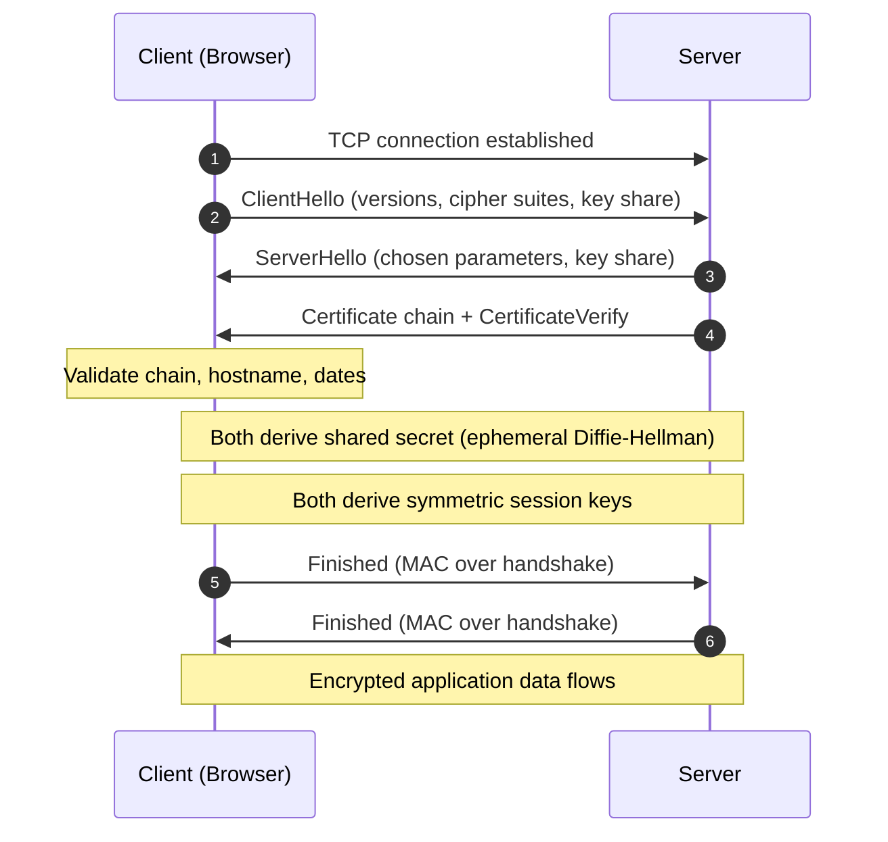

# TLS Handshake: Quick Revision Note

## 1. Overview
TLS (Transport Layer Security) does two jobs for a connection between a client and a server:
- **Authenticates the server.** The client checks that the server is who it claims to be, using a certificate.
- **Establishes shared session keys.** Both sides derive the same symmetric keys, which encrypt all application data after the handshake.

Public-key cryptography is used to authenticate the server and agree on key material. Symmetric cryptography, which is much faster, protects the actual traffic.

### Core mental model
The handshake has three goals in order: **agree on parameters**, **prove the server's identity**, and **derive shared keys**. Only after all three does encrypted data flow.

## 2. The Handshake, Step by Step
1. **TCP connection.** The client (usually a browser) opens a TCP connection to the server. The TLS handshake runs on top of it.
2. **ClientHello.** The client sends the TLS versions it supports, a list of cipher suites, and (in TLS 1.3) its key-share information.
3. **ServerHello.** The server picks the TLS version and cipher suite from the client's list, and sends its own key-share information.
4. **Server certificate and proof.** The server sends its certificate chain. The certificate binds the server's identity (such as `www.google.com`) to a public key and is signed by a trusted Certificate Authority (CA), either directly or through intermediate CAs. The server also signs the handshake transcript with its private key (`CertificateVerify`). This proves it holds the private key matching the certificate.
5. **Certificate validation.** The browser checks the chain of signatures up to a trusted root CA, checks that the hostname matches, and checks the validity dates. If any check fails, the browser refuses to continue.
6. **Key agreement.** Client and server use **ephemeral Diffie-Hellman** to derive a shared secret. Each side contributes a temporary key share, so no secret is ever sent in the clear.
7. **Session-key derivation.** Both sides derive matching symmetric traffic keys from the shared secret and the handshake transcript.
8. **Finished messages.** Each side sends a `Finished` message, a MAC over the handshake. Each side checks it, which confirms that nothing was tampered with and both derived the same keys.
9. **Encrypted communication.** Application data is encrypted and authenticated with the symmetric session keys.
10. **Connection ends.** The traffic keys are discarded when the connection closes. A later connection can run a new handshake, or resume a previous session with a pre-shared key (session resumption) to skip most of the work.

## 3. Certificate Trust Chain
A browser does not trust a server certificate on its own. It trusts it because a chain of signatures leads back to a root CA that is already in the browser or operating system's trust store.

Key points about the chain:
- A **CA's private key signs** certificates. The browser verifies each signature with the matching **CA public key**.
- The browser checks the certificate's **contents** (hostname, validity dates, purpose). It does not decrypt the certificate to prove identity. Verifying the signature is what proves it.

## 4. Sequence View of the Handshake

## 5. TLS 1.2 vs TLS 1.3

| Feature | TLS 1.2 | TLS 1.3 |
|---|---|---|
| Full handshake round trips | 2 | 1 |
| Key exchange | RSA or (EC)DHE | Ephemeral (EC)DHE only |
| Forward secrecy | Only if an ephemeral key exchange is chosen | Always |
| Handshake encryption | Certificate sent in the clear | Certificate sent encrypted under handshake keys |
| Insecure legacy algorithms | Still allowed if configured | Removed |

## 6. Key Takeaways
- **TLS authenticates the server and sets up shared keys.** These are two separate jobs, done by different steps.
- **Certificate validation answers "who is this server?"** The browser verifies the CA's signature and checks the hostname and dates.
- **Key agreement answers "how do we share a secret?"** Ephemeral Diffie-Hellman produces the shared secret, and session keys are derived from it.
- **Public-key cryptography is used only for the handshake.** Symmetric encryption handles the bulk of the data because it is much faster.
- **Ephemeral keys give forward secrecy.** If the server's long-term key is stolen later, past sessions still cannot be decrypted.
- **TLS 1.3 is the modern standard.** It needs one round trip for a full handshake and removes weak key exchanges.

## 7. Interview Tip
If asked to explain TLS, separate **certificate validation** from **key agreement**. They are related but distinct:
- Validation checks **who the server is**.
- Key agreement establishes **the shared secret** used to derive traffic keys.

## 8. Quick Revision Checklist
- [ ] Can I name the two jobs TLS performs?
- [ ] Can I list the handshake steps in order, from ClientHello to encrypted data?
- [ ] Can I explain what the browser checks in a certificate, and in what order?
- [ ] Can I explain how a certificate chain leads back to a trusted root CA?
- [ ] Can I explain what the server's `CertificateVerify` message proves?
- [ ] Can I explain why ephemeral Diffie-Hellman gives forward secrecy?
- [ ] Can I explain why TLS uses both public-key and symmetric cryptography?
- [ ] Can I explain the difference between certificate validation and key agreement?
