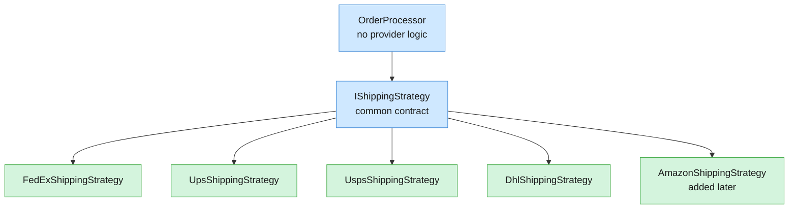

# Strategy Design Pattern: Replacing Conditionals with Interchangeable Behaviour

> **About the code:** The source talks through its code without showing it in full. The C# snippets in this note are reconstructions of what the speaker describes (`IShippingStrategy`, `IEnumerable` injection, `TryGetValue`, `AddTransient`). They are illustrative, not copied from the video. Method bodies are placeholders.

## 1. Overview

The strategy pattern is a behavioral pattern that lets you swap interchangeable algorithms behind a common interface. Instead of one class that branches on a type or provider name with a `switch` or long `if` chain, each variant becomes its own class, and the caller depends only on the shared abstraction. The main example is calculating shipping cost across providers (FedEx, UPS, USPS, DHL). A second example, sending order notifications by email, SMS, push, post, and carrier pigeon, shows the same idea. The pattern's main payoff is that you can add new behaviour without modifying the existing caller, which keeps it open for extension and closed for modification.

### Core mental model



The caller depends on one abstraction. Each concrete strategy implements it. Adding a provider means adding a node on the right, not editing the caller.

## 2. The Problem: A Central Class That Knows Everything

The starting point is an `OrderProcessor` with a `CalculateShippingCost` method. It takes the provider name and runs a `switch` with one case per provider. This causes several problems:

- **Open/closed violation.** Supporting a new provider means editing `OrderProcessor`, even though its existing behaviour is correct.
- **Growing complexity.** Each provider's logic adds lines. In a real codebase the class could reach hundreds or thousands of lines.
- **Merge conflicts.** Several developers working on different providers all edit the same file.
- **Dependency bloat.** If one provider needs an external API, that dependency is forced into `OrderProcessor`. Every other provider then carries a dependency it never uses.

The speaker's rule of thumb: a large `if` block or `switch` that keeps growing is a strong signal that the strategy pattern may fit.

## 3. Find the Common Contract

Before extracting anything, identify what the variants have in common:

- Each one needs the **order** as input.
- Each may need **dependencies**, which are supplied through dependency injection rather than created inside the class.
- Each returns the **shipping cost as a `decimal`**.
- Each is identified by a **provider name** string, which the caller uses to pick the right one.

These become the interface. The speaker calls it `IShippingStrategy`:

```csharp
public interface IShippingStrategy
{
    string ProviderName { get; }
    decimal CalculateCost(Order order);
}
```

The naming follows the `I` prefix convention for interfaces in C#. The `ProviderName` property is what the caller later uses as the lookup key.

## 4. Turn Each Branch into Its Own Class

Each `case` in the `switch` moves into a class that implements the interface. The speaker copies the original logic over unchanged, then renames and adjusts it per provider:

```csharp
public class FedExShippingStrategy : IShippingStrategy
{
    public string ProviderName => "FedEx";   // read-only: no setter

    public decimal CalculateCost(Order order)
    {
        // FedEx calculation, moved verbatim from the old switch case
        return 0m;
    }
}
```

Points to notice:

- `ProviderName` is an expression-bodied property with only a getter. The speaker describes it as a "readonly property". It always returns the same value and can't be changed at runtime.
- The class holds all the logic for one provider and nothing else. Someone reading `FedExShippingStrategy` doesn't need to understand UPS or DHL.
- The same steps repeat for `UpsShippingStrategy`, `UspsShippingStrategy`, and `DhlShippingStrategy`. Each gets its own file, typically in a `Strategies` folder.

### Handling a provider-specific dependency

Suppose USPS needs an external fee service. Only the USPS class changes. The dependency is injected through its constructor:

```csharp
public interface IUspsApi
{
    decimal GetHandlingFee(Order order);
}

public class UspsShippingStrategy : IShippingStrategy
{
    private readonly IUspsApi _uspsApi;

    public UspsShippingStrategy(IUspsApi uspsApi)
    {
        _uspsApi = uspsApi;
    }

    public string ProviderName => "USPS";

    public decimal CalculateCost(Order order)
    {
        var baseCost = 0m;   // original USPS calculation
        return baseCost + _uspsApi.GetHandlingFee(order);
    }
}
```

In the old design, this dependency would have been added to `OrderProcessor`, and every provider would have carried it. Here, FedEx, UPS, and the others never see `IUspsApi`. The speaker reverts this change afterwards to keep the testing example simple, but the point stands.

## 5. Wire It Up: Dictionary Lookup Through Dependency Injection

The caller no longer contains provider logic. It receives every registered strategy and indexes them by provider name:

```csharp
public class OrderProcessor
{
    private readonly Dictionary<string, IShippingStrategy> _shippingStrategies;

    public OrderProcessor(IEnumerable<IShippingStrategy> strategies)
    {
        _shippingStrategies = strategies.ToDictionary(s => s.ProviderName);
    }

    public decimal CalculateShippingCost(Order order, string shippingProvider)
    {
        if (!_shippingStrategies.TryGetValue(shippingProvider, out var strategy))
        {
            throw new ArgumentException($"Unsupported shipping provider: {shippingProvider}");
        }

        return strategy.CalculateCost(order);
    }
}
```

How it works:

- **`IEnumerable<IShippingStrategy>`** is the key input. The DI container passes in every registered implementation as a collection.
- **`ToDictionary(s => s.ProviderName)`** builds a lookup from provider name to strategy, so the caller doesn't loop through the collection on each call.
- **`TryGetValue` with `out var`** is a single safe lookup. It returns `false` for unknown providers, so the code throws an `ArgumentException` in that case. The `!` in the `if` means "not found". After the guard, `strategy` is guaranteed non-null.
- **The `switch` is gone.** The method is now a lookup plus one delegated call.

Registration happens in the composition root, usually `Program.cs` or `Startup.cs`:

```csharp
services.AddTransient<OrderProcessor>();
services.AddTransient<IShippingStrategy, FedExShippingStrategy>();
services.AddTransient<IShippingStrategy, UpsShippingStrategy>();
services.AddTransient<IShippingStrategy, UspsShippingStrategy>();
services.AddTransient<IShippingStrategy, DhlShippingStrategy>();
```

Registering the same service interface multiple times is what makes the container supply an `IEnumerable<IShippingStrategy>`.

> **Caveat:** `ToDictionary` throws if two strategies return the same `ProviderName`. The duplicate key is caught at startup or first use, which is usually what you want, but it's worth knowing.

The speaker's note about maintenance cost also applies here. The code now spans several files, and that's the trade-off for the cleaner structure.

## 6. Extending Without Modifying: Adding Amazon

This is the central payoff. To support Amazon, you do three things and never touch `OrderProcessor`:

1. Create a class that implements `IShippingStrategy`:

```csharp
public class AmazonShippingStrategy : IShippingStrategy
{
    public string ProviderName => "Amazon";

    public decimal CalculateCost(Order order)
    {
        // Amazon-specific rules
        return 0m;
    }
}
```

2. Register it in the composition root:

```csharp
services.AddTransient<IShippingStrategy, AmazonShippingStrategy>();
```

3. Call the processor with `"Amazon"` as the provider. The dictionary already contains it.

The speaker tests this by passing only Amazon into the setup and stepping through the lookup. The dictionary is populated automatically by DI, so there's no extra wiring.

## 7. Benefits and Trade-offs

| Concern | Switch statement | Strategy pattern |
|---|---|---|
| Adding a provider | Edit the central class | Add a class and register it |
| Open/closed principle | Violated | Respected |
| Size of the central class | Grows with every provider | Stays constant |
| Dependencies | All providers' dependencies in one class | Each strategy declares only its own |
| Testing one variant | Must build the whole processor | Test the strategy in isolation |
| Merge conflicts | Frequent, same file | Rare, separate files |
| Number of files and classes | One | One per variant, plus the interface |
| Ease of reading one variant | Hunt through the switch | Open one class |

The main cost is more files and classes to maintain. The speaker's view is that this cost is small compared to the complexity it removes, especially once each variant has real logic and dependencies.

## 8. The Same Pattern in a Notification Service

The second example applies the pattern to sending notifications when an order ships.

### Before: Branching on configuration

The original `ShipOrder` sets the status to shipped, then sends a notification by checking app configuration. Every new channel means a new `if` branch:

```csharp
public void ShipOrder(Order order, AppConfig config)
{
    order.Status = OrderStatus.Shipped;

    if (config.NotificationType == "email")
        _emailService.Send(order);
    else if (config.NotificationType == "sms")
        _smsService.Send(order);
    // Push notifications would be another branch here
}
```

### After: A common notifier interface

The speaker creates `IOrderNotifier` with one method, `NotifyOrderShipped`. The email and SMS services implement it:

```csharp
public interface IOrderNotifier
{
    void NotifyOrderShipped(Order order);
}

public class EmailService : IOrderNotifier
{
    public void NotifyOrderShipped(Order order)
    {
        // send email
    }
}

public class SmsService : IOrderNotifier
{
    public void NotifyOrderShipped(Order order)
    {
        // send SMS
    }
}
```

`OrderService` now depends only on the interface. Configuration checks and `if` blocks are removed:

```csharp
public class OrderService
{
    private readonly IOrderNotifier _notifier;

    public OrderService(IOrderNotifier notifier)
    {
        _notifier = notifier;
    }

    public void ShipOrder(Order order)
    {
        order.Status = OrderStatus.Shipped;
        _notifier.NotifyOrderShipped(order);
    }
}
```

Adding push notifications, postal letters, or carrier pigeon means creating another `IOrderNotifier` implementation. `OrderService` doesn't change:

```csharp
public class PushNotifier : IOrderNotifier
{
    public void NotifyOrderShipped(Order order) { /* push */ }
}

public class CarrierPigeonNotifier : IOrderNotifier
{
    public void NotifyOrderShipped(Order order) { /* pigeon */ }
}
```

> **Gap in the source:** The transcript doesn't say how the correct notifier gets chosen at runtime. `OrderService` receives one `IOrderNotifier`, so something must decide which one. In a real app this is a DI registration decision, or a small factory or selector that reads configuration once, at the composition root. It shouldn't be an `if` inside `ShipOrder`. Also, the second transcript ends mid-sentence, so the rest of its explanation is missing.

## 9. Key Takeaways

- The strategy pattern replaces a `switch` or long `if` chain on a type or name with an interface and one class per variant, so the caller no longer contains variant-specific logic.
- Common behaviour (inputs, outputs, and a lookup key) belongs in the interface. Variant-specific behaviour and dependencies belong in each concrete class.
- Dependency injection is what makes the pattern practical. The container supplies every registered strategy as an `IEnumerable`, and the caller indexes them by key.
- Adding a new variant means implementing the interface and registering it. The caller and existing variants stay untouched, which satisfies the open/closed principle.
- Each strategy can be tested in isolation, with only its own dependencies mocked.
- The cost is more classes and files. The pattern pays off most when variants have significant logic, their own dependencies, or are likely to grow.
- The same pattern works outside shipping. Notifications, payment methods, and pricing rules all follow the same shape.

## 10. Quick Revision Checklist

- [ ] Can I name the three problems with a central `switch` that the strategy pattern solves (open/closed violation, growing class, dependency bloat)?
- [ ] Can I explain why the common contract (`IShippingStrategy`) includes the lookup key (`ProviderName`)?
- [ ] Can I write a strategy interface and one implementation from memory?
- [ ] Can I explain why a provider-specific dependency belongs in its strategy's constructor and not in the caller?
- [ ] Can I explain how `IEnumerable<IShippingStrategy>` plus `ToDictionary` replaces the `switch`?
- [ ] Do I know what `TryGetValue` with `out var` does, and why the code throws when it returns `false`?
- [ ] Can I list the three steps to add a new provider without modifying the caller?
- [ ] Can I name at least two trade-offs of the strategy pattern (more classes, more files, extra indirection)?
- [ ] Can I explain how the notification example applies the same pattern to `OrderService`?
- [ ] Do I know where the runtime choice of strategy should live (the composition root, not inside the method)?
